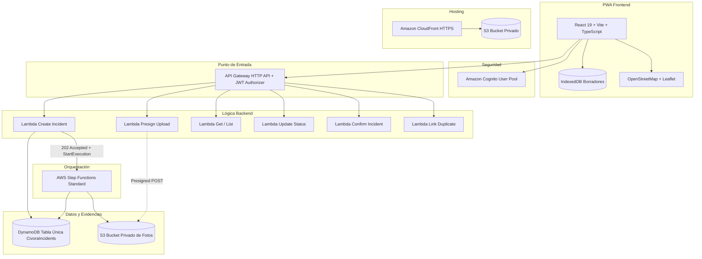

<div align="center">
  
  <h1>Civora — Alerta Vecinal</h1>
  <p><strong>Plataforma PWA serverless para reporte, mapa interactivo y seguimiento colaborativo de incidentes comunitarios con detección explicable de duplicados.</strong></p>

  [](https://github.com/PonchoSaldana/Civora-Neighborhood-Alert.git)
  [](https://aws.amazon.com/)
  [](https://developer.mozilla.org/es/docs/Web/Progressive_web_apps)
  [](LICENSE)
</div>

---

## Acerca de Civora

**Civora** es una solución web progresiva (PWA) serverless diseñada para empoderar a vecinos y comunidades en el reporte ciudadano de fallas y desperfectos en su entorno (baches, fugas de agua, luminarias descompuestas, basura acumulada o daños en infraestructura).

A diferencia de sistemas tradicionales que generan reportes dispersos e ignorados, Civora incorpora **detección explicable de duplicados** para sugerir coincidencias basadas en cercanía geográfica y temporal, permitiendo a la comunidad apoyar reportes existentes y a los administradores dar seguimiento trazable de principio a fin.

---

##  Características Principales

-  **Mapa Interactivo con Geolocalización:**
  - Visualización de incidentes cercanos mediante **OpenStreetMap** y **Leaflet**.
  - Detección de ubicación GPS actual con marcador pulsante.
  - Cálculo de distancia en tiempo real (*"A 150 m de ti"*).
  - Filtro por radio de proximidad (500 m, 1 km, 3 km, 5 km o todos).
  - Pines con código de color según el estado del reporte.

-  **Reportes Rápidos y Flexibles:**
  - Formulario ágil: categoría, título, descripción, zona comunitaria y coordenadas opcionales.
  - **Identificación opcional:** posibilidad de reportar con tu nombre o en modo **totalmente anónimo**.
  - Carga segura de evidencia fotográfica (JPEG, PNG, WebP) de hasta 5 MB directo a S3 privado.

-  **Roles Simplificados:**
  - **`USUARIO`:** Puede explorar el mapa y la lista comunitaria, crear reportes (con nombre o anónimos), apoyar incidencias para darles visibilidad y aportar comentarios.
  - **`ADMIN`:** Dispone de todas las capacidades de usuario más herramientas de gestión: actualización de estados (`RECIBIDO` → `EN_REVISION` → `ASIGNADO` → `EN_PROCESO` → `RESUELTO` / `NO_PROCEDENTE`), vinculación trazable de duplicados y comentarios con insignia oficial.

-  **Comentarios Comunitarios:**
  - Espacio de discusión en cada reporte para que vecinos y administradores compartan actualizaciones del problema.
  - Soporte de comentarios identificados o anónimos.

-  **Detección Explicable de Duplicados (Sin caja negra):**
  - Heurística transparente que evalúa 4 factores (puntuación 0–100):
    - **Categoría:** 40 pts
    - **Distancia geográfica (Haversine/geohash):** hasta 30 pts
    - **Ventana temporal (≤ 7 días):** hasta 15 pts
    - **Similitud textual:** hasta 15 pts
  - **Revisión humana obligatoria:** El sistema nunca borra ni fusiona registros automáticamente; sugiere al administrador los candidatos con las razones explícitas para su decisión.

-  **PWA y Soporte Offline (IndexedDB):**
  - Instalable en dispositivos móviles y de escritorio en modo `standalone`.
  - Si no hay conexión, los reportes se guardan localmente como borradores en **IndexedDB** y se sincronizan al volver a tener internet.

-  **Diseño Liquid Glass Sobrio:**
  - Interfaz moderna con vidrio translúcido y desenfoque (`backdrop-filter`) enfocado en barras de navegación, hojas modales y tarjetas flotantes.
  - Modo **Claro**, **Oscuro** y **Sistema** sin parpadeo (*no-flicker script*).

---

##  Arquitectura Técnica en AWS

Civora utiliza un diseño 100% serverless de pago por uso:



| Componente | Tecnología | Propósito |
|---|---|---|
| **Frontend** | React 19, Vite, TypeScript, Workbox | PWA responsiva con soporte offline |
| **Mapas** | Leaflet, OpenStreetMap / CartoDB | Mapeo interactivo y cálculo de proximidad |
| **Autenticación** | Amazon Cognito | Cuentas, JWT authorizer y grupos |
| **API** | AWS API Gateway (HTTP API v2) | Endpoints REST con validación JWT |
| **Backend** | AWS Lambda (Node.js 22, TypeScript) | Microfunciones de mínimo privilegio |
| **Base de Datos** | Amazon DynamoDB | Tabla única On-Demand con índices GSI |
| **Evidencias** | Amazon S3 | Almacenamiento privado de fotos con presigned URLs |
| **Orquestación** | AWS Step Functions Standard | Validación asíncrona y cálculo de duplicados |
| **Infraestructura** | AWS SAM (`template.yaml`) | Despliegue reproducible con IaC |

---

##  Estructura del Proyecto

```
civora/
├── apps/pwa/                  # Aplicación Frontend React + Vite + TypeScript
│   ├── public/                # Iconos, logo oficial, manifest PWA
│   ├── src/
│   │   ├── components/        # Header, BottomNav, IncidentCard, DuplicateCard, StatusChip
│   │   ├── context/           # AuthContext (Usuario/Admin/Invitado), ThemeContext
│   │   ├── pages/             # HomePage, MapPage, NewIncidentPage, MyIncidentsPage, AccountPage, ManagerInboxPage, IncidentDetailPage, LoginPage
│   │   ├── services/          # api.ts (cliente API + fallback demo), db.ts (IndexedDB)
│   │   └── styles/            # tokens.css (variables de diseño), glass.css (receta de vidrio)
│   └── vite.config.ts         # Configuración Vite y Workbox PWA
├── src/functions/             # Funciones AWS Lambda (Node.js 22 + TypeScript)
│   ├── createIncident.ts      # Registro preliminar y arranque de Step Functions (202 Accepted)
│   ├── presignUpload.ts       # Generación de URLs presignadas POST para S3
│   ├── getIncidents.ts        # Consultas optimizadas con índices GSI (sin Scan)
│   ├── getIncidentById.ts     # Detalle, historial de eventos y fotos temporales firmadas
│   ├── updateStatus.ts        # Transiciones de estado validadas
│   ├── confirmIncident.ts     # Apoyo único trazable por usuario
│   ├── linkDuplicate.ts       # Vinculación de duplicados con suma de confirmaciones
│   └── processIncidentStep.ts # Tarea de Step Functions para HeadObject y duplicados
├── src/shared/                # Lógica compartida
│   ├── duplicates.ts          # Algoritmo determinista de puntuación de duplicados
│   ├── status.ts              # Validador de máquina de estados
│   ├── types.ts               # Interfaces TypeScript compartidas
│   └── validation.ts          # Esquemas de validación Zod
├── statemachine/              # Definición ASL de Step Functions (incident.asl.json)
├── template.yaml              # Plantilla de infraestructura AWS SAM
├── tests/                     # Pruebas unitarias automatizadas con Vitest
└── docs/                      # architecture.md, decisions.md
```

---

## Inicio Rápido Local

### 1. Prerrequisitos
- **Node.js** v20+ o v22+
- **npm** v10+
- Navegador moderno con soporte para PWA

### 2. Instalación y dependencias
```bash
git clone https://github.com/PonchoSaldana/Civora-Neighborhood-Alert.git
cd Civora-Neighborhood-Alert
npm install
```

### 3. Ejecutar el servidor de desarrollo
```bash
npm run dev
```

Abre en tu navegador: **[http://localhost:5173](http://localhost:5173)**

> **Nota:** La aplicación cuenta con un modo de demostración local integrado con datos sintéticos y soporte offline, por lo que puedes probar el flujo completo (creación de reportes, mapa interactivo, comentarios, cambio de roles y detección de duplicados) inmediatamente sin necesidad de credenciales de AWS activas.

### 4. Pruebas unitarias
```bash
npm test
```

---

##  Configuración de Variables de Entorno

Para conectar Civora a tus servicios de AWS o a un proveedor específico de mapas, crea un archivo `.env.local` en la raíz o dentro de `apps/pwa/.env.local`:

```bash
# Backend API (API Gateway HTTP API)
VITE_API_URL=https://tu-api-id.execute-api.us-east-1.amazonaws.com/dev

# Amazon Cognito
VITE_COGNITO_USER_POOL_ID=us-east-1_xxxxxxxxx
VITE_COGNITO_CLIENT_ID=xxxxxxxxxxxxxxxxxxxxxxxxxx
VITE_AWS_REGION=us-east-1

# OpenStreetMap / Proveedor de Mosaicos (Opcional)
# 1. OpenStreetMap libre estándar (no requiere API key):
VITE_OSM_TILE_URL=https://tile.openstreetmap.org/{z}/{x}/{y}.png

# 2. Si usas un proveedor con clave (Geoapify, Stadia, Mapbox, Thunderforest):
# VITE_MAP_API_KEY=tu_api_key_aqui
# VITE_OSM_TILE_URL=https://maps.geoapify.com/v1/tile/osm-bright/{z}/{x}/{y}.png?apiKey={apiKey}
```

---

##  Despliegue en AWS con AWS SAM

Cuando cuentes con credenciales configuradas en tu entorno AWS CLI (`aws configure`), puedes desplegar toda la infraestructura serverless con SAM:

```bash
# 1. Compilar recursos serverless
sam build

# 2. Desplegar guiado por primera vez
sam deploy --guided --stack-name civora-dev --region us-east-1

# 3. Subir el frontend generado al bucket S3 de hosting
npm run build
aws s3 sync apps/pwa/dist s3://civora-frontend-[AccountId]-us-east-1-dev/ --delete
```

---

##  Contribuciones y Repositorio

- **Repositorio oficial:** [https://github.com/PonchoSaldana/Civora-Neighborhood-Alert](https://github.com/PonchoSaldana/Civora-Neighborhood-Alert.git)
- **Autor:** Alfonso Saldaña Camacho ([@PonchoSaldana](https://github.com/PonchoSaldana))

---

