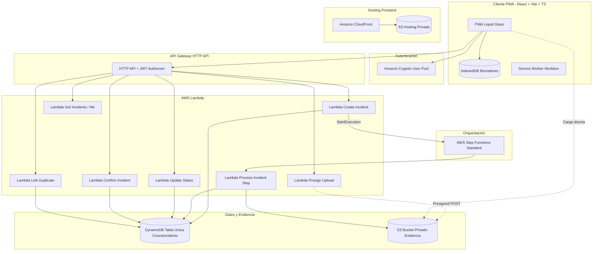

# Arquitectura Serverless — Civora

Diagrama de flujo end-to-end y componentes en AWS para Civora.

---

## Flujo de reporte con fotografía y Step Functions

1. **Autenticación:** El usuario autentica sesión con Amazon Cognito (User Pool con grupos `REPORTER`, `MANAGER`, `ADMIN`).
2. **Presigned URL:** El cliente solicita `POST /uploads/presign` pasando tipo MIME (JPEG/PNG/WebP) y peso (<= 5 MB). Lambda valida y retorna política presigned POST de S3 de 5 minutos con prefijo `uploads/{userSub}/`.
3. **Carga directa a S3:** El navegador sube el archivo directamente a S3 privado (sin pasar los bytes por Lambda ni API Gateway).
4. **Creación de reporte:** La PWA envía `POST /incidents` con los metadatos, la referencia `objectKey` y el header `Idempotency-Key`.
5. **Respuesta 202 y disparo:** Lambda guarda el registro preliminar en DynamoDB (`status=RECIBIDO`, `isProcessing=true`), arranca Step Functions Standard y responde **202 Accepted** con `incidentId` y `executionArn`.
6. **Validación y duplicados:** Step Functions ejecuta la tarea que corre `HeadObject` en S3 para verificar la foto, consulta DynamoDB y aplica el algoritmo determinista de duplicados con explicación. Actualiza DynamoDB y desactiva `isProcessing`.
7. **Lectura y visualización:** La PWA consulta `GET /incidents/{id}`, muestra el progreso en vivo y, una vez completado, despliega el reporte con fotos mediante URLs firmadas breves y candidatos a duplicados al gestor.

